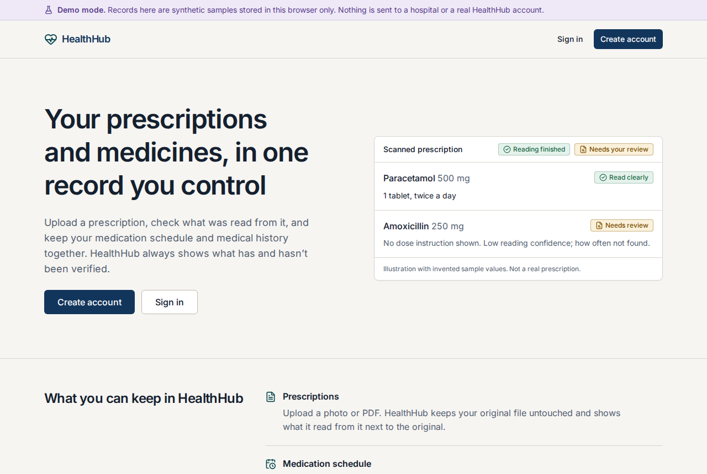
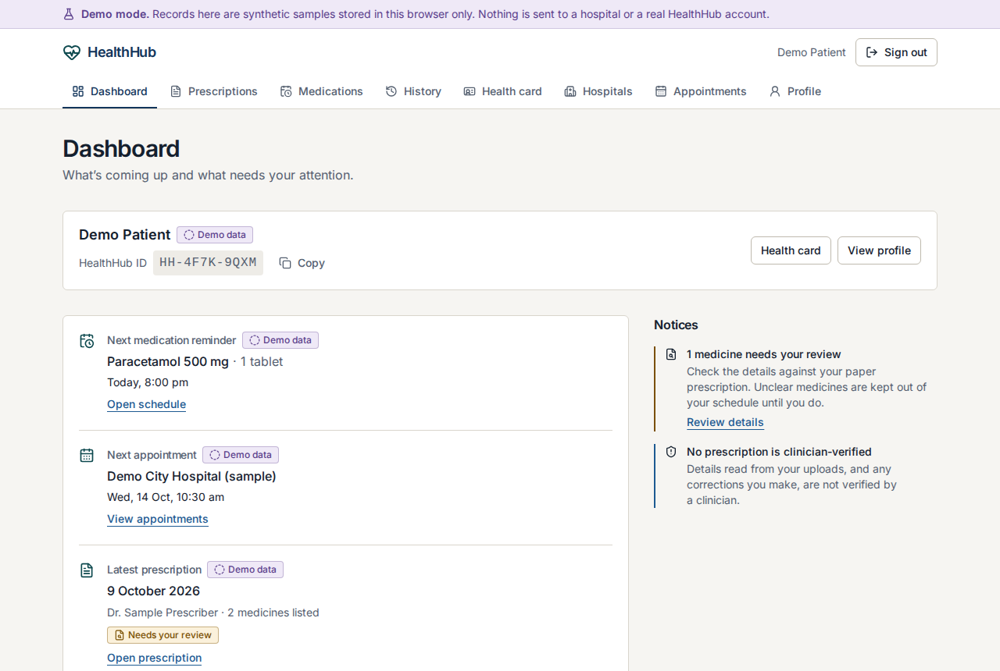
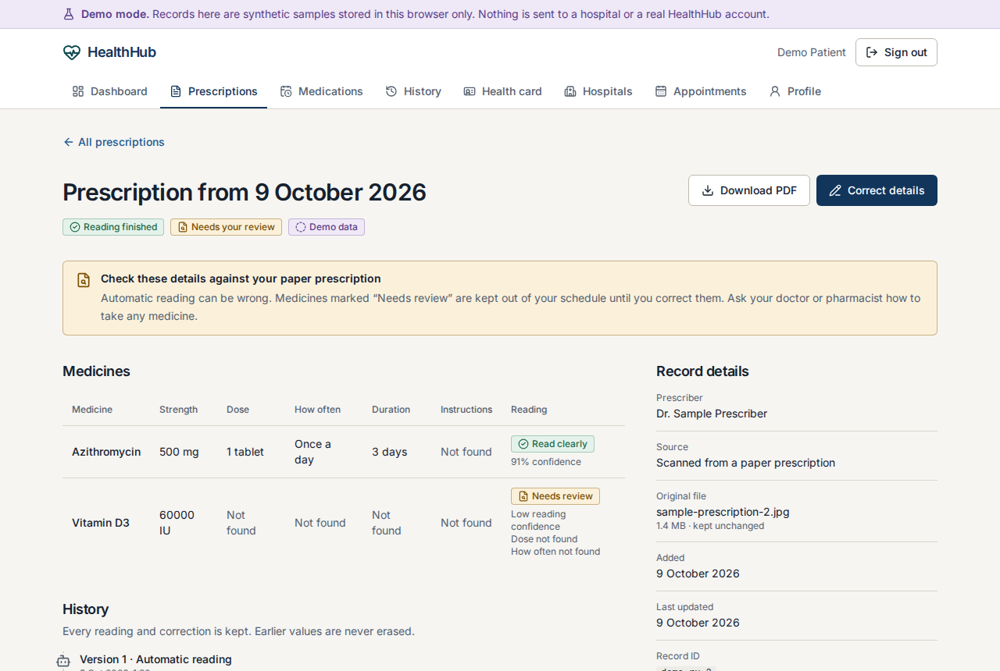
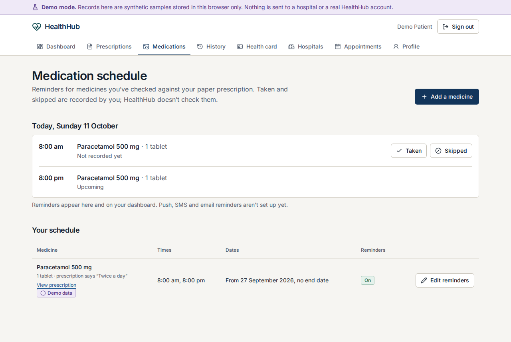
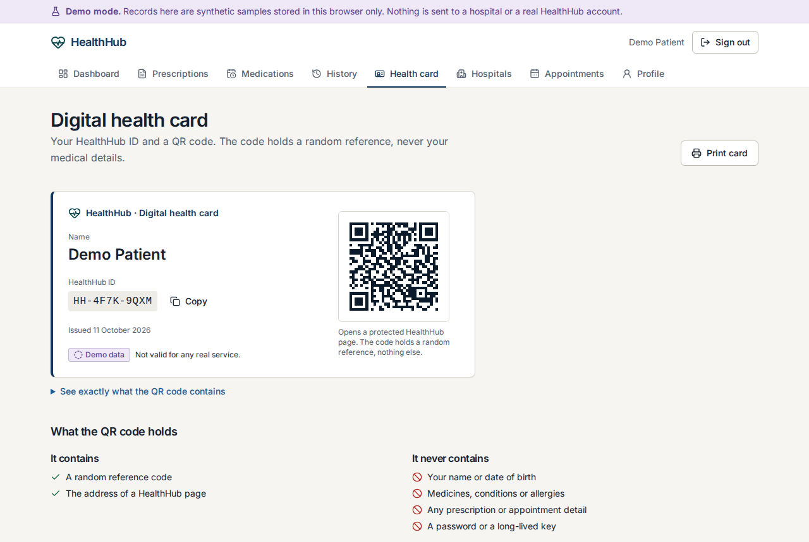
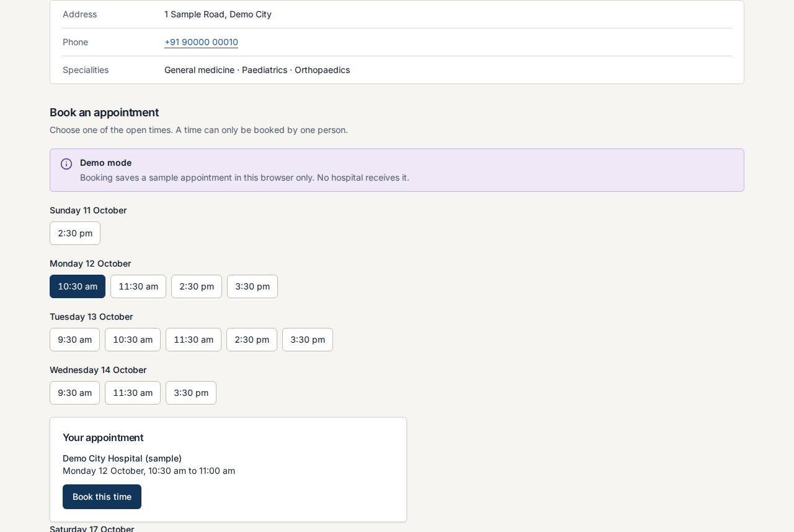
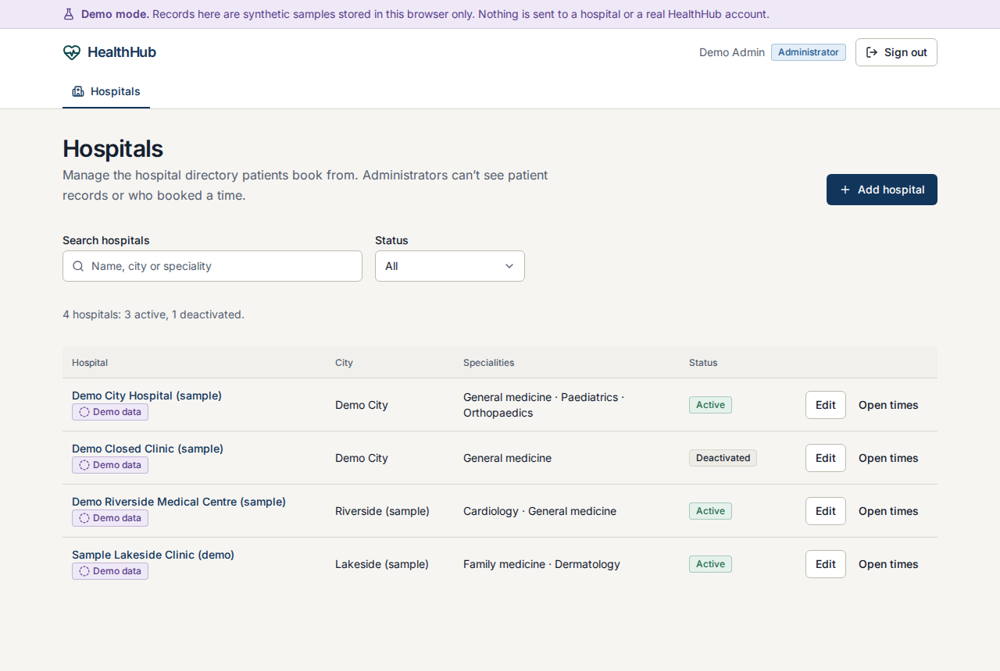

# HealthHub web

The patient and admin web app for HealthHub, built with Next.js (App Router), TypeScript, Tailwind CSS and shadcn/ui-style
components. It owns `apps/web/**` only.

**Status: a working front end, not a product.** It runs fully in **demo mode** with typed sample adapters. It has never
been run against a real HealthHub API (none exists in this repository yet), so every request and response shape marked
`ASSUMED` in [`src/lib/api/types.ts`](src/lib/api/types.ts) is a guess until the backend owner confirms it.

| Landing | Dashboard | Prescription review |
|---|---|---|
|  |  |  |

| Medication schedule | Health card | Booking | Admin |
|---|---|---|---|
|  |  |  |  |

*All screenshots are demo mode with synthetic data.*

## Run it (demo mode)

Needs Node ≥ 20.9 (developed on 22) and npm.

```bash
cd apps/web
npm ci
npm run dev        # http://localhost:3000 — demo mode is the default, no backend and no .env needed
```

Demo accounts (synthetic, shown on the sign-in page too):

| Role | Email | Password |
|---|---|---|
| Patient (has sample records) | `demo.patient@healthhub.test` | `DemoPatient#1` |
| Administrator | `demo.admin@healthhub.test` | `DemoAdmin#1` |

Anyone can also **create an account** in demo mode. It starts with an empty record (no password is stored).

Other commands: `npm run lint`, `npm run typecheck`, `npm run build`, `npm start`. Browser tests: see [`e2e/README.md`](e2e/README.md).

## Demo mode vs live mode

Set with `NEXT_PUBLIC_API_MODE` (see `.env.example`). It is read **at build time**.

| Variable | Used for |
|---|---|
| `NEXT_PUBLIC_API_MODE` | `demo` (default) or `live` |
| `API_ORIGIN` | Where the Express API runs. `/api/v1/*` is proxied there in live mode, so the session cookie is first-party. Default `http://localhost:4000` |
| `AUTH_COOKIE_NAME` | Name of the API's httpOnly session cookie. Only used to redirect signed-out visitors early. Default `hh_session` |

**Demo mode** shows a banner on every page and tags sample records "Demo data". Everything is simulated in the browser:
data lives in `localStorage` (keys starting `healthhub-demo`; clear site data to reset), shared by every demo account in that browser.
Specifically simulated:

- **Prescription reading.** Your uploaded file is never read or sent anywhere. After about 3 seconds the record is filled from a fixed sample. A file name containing `unreadable` simulates a failed reading.
- **Booking.** Saves a sample appointment in the browser. No hospital receives anything. Slots are generated; some are pre-taken.
- **PDF and QR.** The prescription PDF is labelled DEMO. The health card QR points at this app's own `/qr/…` page.
- **Admin.** Changes to hospitals are real within the browser and visible to the patient account.

**Live mode** removes all of that: a live build contains no demo accounts, credentials or sample data (the build check in
`npm run e2e:live` fails if any are found). It calls the API at `/api/v1`, expects an httpOnly session cookie, and has only
been exercised against a **stubbed** API in the browser tests.

## What is built

| Area | Routes |
|---|---|
| Public | `/` landing, `/sign-in`, `/sign-up`, `/qr/[reference]` (what a scanned QR opens: no personal data) |
| Patient | `/dashboard`, `/profile`, `/prescriptions` (+ `/new`, `/[id]`), `/medications` (+ `/new`, `/[id]`), `/history`, `/health-card`, `/hospitals` (+ `/[id]`), `/appointments` |
| Admin | `/admin/hospitals` (+ `/new`, `/[id]`, `/[id]/slots`) |

Behaviour worth knowing, because the product is about health records:

- A medicine with low reading confidence, or a missing name, strength, dose or frequency, is marked **Needs review**. It shows "Not found" for gaps (never a guess), shows no dose instruction, and cannot be scheduled. The rule lives in `src/lib/prescription-safety.ts`.
- A patient's correction is saved as a **new version** and labelled "not verified by a clinician". Earlier values stay visible.
- Medicines read automatically need the patient's confirmation against the paper prescription before reminders are created.
- Dose records ("taken", "skipped") are self-reported and can only be made from one hour before the dose.
- Nothing is shown as booked, saved or paid until the API (or the demo adapter) has confirmed it. A booked slot is refused with a clear message if someone else took it first.
- The QR code holds a random reference only. Administrators can't see patient records or who booked a time.
- Role checks in the UI are a courtesy. **The API must enforce them.**

## Not built, or disabled on purpose

- Google/Apple sign-in (buttons are disabled with the reason stated)
- Family-linked records, and patient controls over QR access (list, end, withdraw consent): no API endpoints exist
- Push, SMS or email reminders; profile photo; previewing the original uploaded file; rescheduling appointments
- Admin slot creation or editing, and reactivating a hospital: not in the API contract
- Payments, insurance, drug-interaction checks, symptom checking

## Open questions for the backend owner

Search for `ASSUMED` in `src/lib/api/types.ts`. The ones that matter most: auth request and response bodies and a
`GET /auth/me`; whether upload starts reading automatically; a file endpoint for the original prescription; whether
dose events can be listed; the booking conflict response (assumed `409`); whether `GET /hospitals` returns deactivated
hospitals to administrators; and every admin call being role-checked on the server.

## Structure

- `src/lib/api/`: typed client (`http.ts`), error envelope, one module per resource. Each module's last statement selects the live client or, in demo builds only, the demo adapter.
- `src/lib/demo/`: demo adapters and sample data. Never imported by a live build.
- `src/components/`: `ui/` primitives, shared `feedback/` states, status badges, then one folder per feature.
- `src/app/`: routes. `(auth)` is public, `(app)` is the signed-in area, `proxy.ts` redirects signed-out visitors in live mode.
- `components.json` is configured for `npx shadcn@latest add <component>`.

## Known issues

- `npm audit` reports 5 high-severity findings, all in the dev-only lint chain (`eslint-config-next` → `braces`). `npm audit --omit=dev` reports none. The suggested fix downgrades to a Next 14 config, so it was not applied.
- In demo mode the server renders protected pages before the browser redirects a signed-out visitor to sign in. In live mode `proxy.ts` redirects them on the server first.
